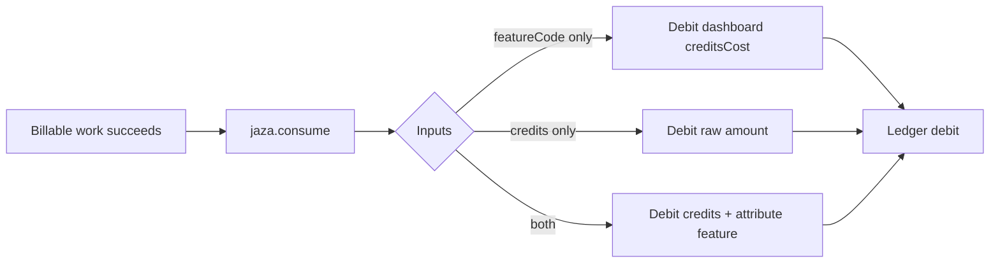

Call `jaza.consume()` from your **backend** after a billable action. Pass a dashboard `featureCode`, raw `credits`, or both — plus an **idempotency key** so retries never double-charge.

Never call consume from the client app. Pair UI gating with [Gating actions](/guides/gating-actions) (`JazaActionButton`), then enforce here.



## Prerequisites

- Features configured in the [dashboard](/guides/dashboard-setup)
- A customer with a wallet (`cus_…`)
- `@jazadev/node` with `secretKey` + `publicKey`

## Fixed cost (feature default)

```ts
import { Jaza } from '@jazadev/node';

const jaza = new Jaza({
  secretKey: process.env.JAZA_SECRET_KEY!,
  publicKey: process.env.JAZA_PUBLIC_KEY!,
});

const result = await jaza.consume({
  customerId: user.jazaCustomerId,
  featureCode: 'SEND_MESSAGE',
  idempotencyKey: `msg_${messageId}`,
});
```

## Variable cost (override)

Pass **both** `featureCode` and `credits` when usage varies (for example AI tokens). Jaza debits the override amount and still stores `featureCode` on the ledger:

```ts
await jaza.consume({
  customerId,
  featureCode: 'AI_CHAT',
  credits: tokenCost, // overrides dashboard default
  idempotencyKey: `ai_${jobId}`,
});
```

## Raw debit

Pass `credits` alone when you need an explicit amount without feature attribution:

```ts
await jaza.consume({
  customerId,
  credits: 10,
  idempotencyKey: `adj_${id}`,
});
```

## Charge after success

Prefer deducting **after** the feature succeeds so failed work is not billed:

```ts
const response = await runBillableFeature(...);
await jaza.consume({
  customerId,
  featureCode: 'AI_PROMPT',
  idempotencyKey: `ai_${jobId}`,
});
return response;
```

## With ActionButton

```tsx
// Client — gate only
<JazaActionButton
  featureCode="SEND_MESSAGE"
  onPress={async () => {
    await fetch(`${API}/api/messages`, { method: 'POST', credentials: 'include' });
  }}
/>
```

```ts
// Host — real debit
await jaza.consume({
  customerId: req.user.jazaCustomerId,
  featureCode: 'SEND_MESSAGE',
  idempotencyKey: `msg_${messageId}`,
});
```

## Errors

The Node SDK throws `JazaError` with `statusCode`, `code`, and `raw`. Handle insufficient balance by prompting a top-up ([Top-up](/guides/top-up)). The client SDK may also open the paywall when Jaza signals insufficient credits over the client realtime channel.

Successful and failed consumes can emit merchant webhooks (`jaza.webhook.consumption.*`). See [Webhooks](/guides/webhooks) and [Errors](/reference/errors).

## Idempotency

Use a key that is **stable for the same business event** (customer + feature + your action id). Do not use a fresh timestamp on every retry, or a timed-out success can deduct twice.

```ts
const idempotencyKey = `consume-${customerId}-SEND_MESSAGE-${messageId}`;
```

## Next steps

- [Gating actions](/guides/gating-actions) · [Features](/concepts/features) · [Node SDK](/sdks/node) · [Ledger](/concepts/ledger)
