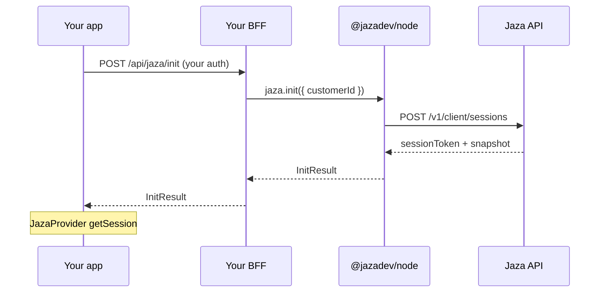

The handshake is the only host route the client SDK needs for balance, ledger, and top-up. Debits still use a separate host route with `jaza.consume`.

## Flow

1. User signs in to **your** app
2. App calls your **`POST /api/jaza/init`** (or similar)
3. Host resolves `customerId` and calls `jaza.init({ customerId })`
4. Host returns `InitResult` (`sessionToken`, wallet/features snapshot, expiry)
5. `JazaProvider` stores the session and calls Jaza **client** APIs with the session JWT + publishable key



<Warning>
  Keep the **secret** key on the server. The app only holds the publishable key and the short-lived session token returned by your BFF.
</Warning>

## Host route

<Tabs>
  <Tab title="Node">
    ```ts
    import { jaza } from './jaza'; // new Jaza({ secretKey, publicKey })

    // POST /api/jaza/init — require your app session first
    app.post('/api/jaza/init', async (req, res) => {
      if (!req.user?.jazaCustomerId) {
        return res.status(401).json({ message: 'Unauthorized' });
      }

      const result = await jaza.init({
        customerId: req.user.jazaCustomerId,
      });

      res.json(result);
    });
    ```
  </Tab>
</Tabs>

`InitResult` includes at least:

| Field | Meaning |
| --- | --- |
| `sessionToken` | Client JWT for Jaza client routes |
| `expiresAt` | Session expiry |
| `customerId` | Jaza customer id |
| `wallet.balanceCredits` | Snapshot balance |
| `features` | Feature codes + costs for gating |
| `ledger` | Optional recent items |

Create the customer once at signup with `jaza.createCustomer`, then store `customer.id` on your user row.

## Provider wiring

Prefer **`getSession`**: a function that hits your init route and returns `InitResult`.

<Tabs>
  <Tab title="React Native">
    ```tsx
    <JazaProvider
      publishableKey={process.env.EXPO_PUBLIC_JAZA_PUBLISHABLE_KEY!}
      getSession={async () => {
        const res = await fetch(`${API_BASE}/api/jaza/init`, {
          method: 'POST',
          credentials: 'include',
        });
        if (!res.ok) throw new Error('Jaza init failed');
        return (await res.json()) as InitResult;
      }}
      onAuthError={() => {
        // re-login or clear local session
      }}
    />
    ```
  </Tab>
  <Tab title="React">
    ```tsx
    <JazaProvider
      publishableKey={process.env.NEXT_PUBLIC_JAZA_PUBLISHABLE_KEY!}
      getSession={async () => {
        const res = await fetch('/api/jaza/init', {
          method: 'POST',
          credentials: 'include',
        });
        if (!res.ok) throw new Error('Jaza init failed');
        return (await res.json()) as InitResult;
      }}
      onAuthError={() => {
        // re-login or clear local session
      }}
    />
    ```
  </Tab>
</Tabs>

### `authEndpoint` alternative

Pass a URL instead of a function. The SDK `POST`s that endpoint and expects the same `InitResult` JSON. If both are set, **`getSession` wins**.

### Legacy `getBalance`

`getBalance` alone still works for older apps, but you should migrate to `getSession` / `authEndpoint` so top-up and ledger use the client session. Do not treat host-minted top-up JWTs (`onRequestToken`) as the primary path.

## Session lifecycle

- After init, the SDK refreshes wallet/ledger via client routes (`GET /v1/client/wallet`, etc.)
- On **401** from a client API, the SDK re-runs the handshake once
- If re-init fails → status `UNAUTHENTICATED` and `onAuthError`
- Use `useJaza().status` (`INITIALIZING` | `AUTHENTICATED` | `UNAUTHENTICATED` | `ERROR`) to gate your UI

## Security checklist

- Secret key only on the host
- Init route requires **your** app authentication
- Never expose `jaza.consume` or secret-backed routes to the device as a public “debit” API without your own auth
- UI gates (`JazaActionButton`) are not authorization — always consume on the server

## Next

- [Top-up](/guides/top-up) — session-minted MoMo checkout
- [Gating actions](/guides/gating-actions) — ActionButton + host consume
- [Authentication](/guides/authentication) — keys and tokens
