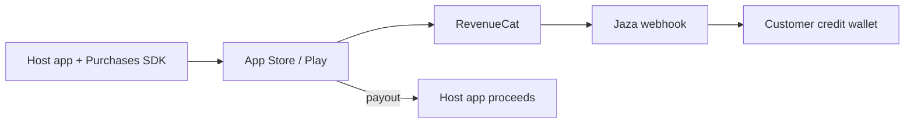

RevenueCat is Jaza's **USD** rail for App Store and Google Play credit packs. Money never enters Jaza's settlement wallet — Apple / Google pay the **host app**. Jaza records a payment request and credits the customer wallet so metering and the merchant dashboard stay consistent.

## Setup

1. Seed / enable the `REVENUECAT` payment gateway (`npm run seed` in `jaza-api`).
2. Set `REVENUECAT_WEBHOOK_SECRET` and point RevenueCat's server webhook to:

   `POST https://<api-host>/v1/webhooks/revenuecat`

   Authorization: `Bearer <REVENUECAT_WEBHOOK_SECRET>`

3. Create **USD** consumable (or non-renewing) products in App Store Connect / Play Console and RevenueCat.
4. On each Jaza bundle, set `revenueCatProductId` to the store product id (dashboard PATCH or API).

## Host app flow

1. Ensure a Jaza customer exists (`cus_…`).
2. `Purchases.logIn(jazaCustomerId)` so RevenueCat's `app_user_id` matches.
3. Purchase the package that maps to the bundle's `revenueCatProductId`.
4. Wait for `jaza.webhook.topUp.completed` (or poll the wallet). Do **not** call `POST /v1/credits/credit` for the same purchase — the webhook owns the grant.

## Events credited

- `INITIAL_PURCHASE`
- `NON_RENEWING_PURCHASE`

Other RevenueCat types are acknowledged and ignored. Sandbox → Jaza `TEST`; Production → `LIVE`.

## Settlement

| Rail | Customer credits | App settlement wallet |
|------|------------------|------------------------|
| Mobile Money (PawaPay) | Yes | Yes (gross − platform fee) |
| RevenueCat IAP | Yes | **No** (store pays the app) |

## Public SDK note

Compose RevenueCat in the host app; do not embed StoreKit inside `@jazadev/react-native`. Future public docs will describe this same webhook + product mapping pattern.
