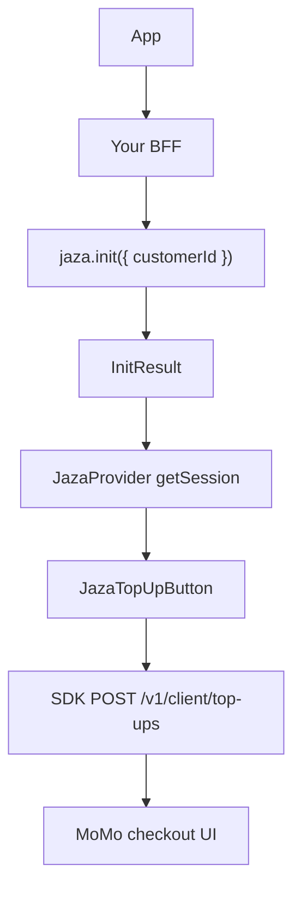

Top-up uses **both** SDKs on the primary path:

1. **Backend** — `@jazadev/node` mints a **client session** with `jaza.init` (host handshake).
2. **Client** — `@jazadev/react-native` or `@jazadev/react` opens MoMo checkout; the SDK mints the top-up JWT from that session.



## Prerequisites

- [Dashboard setup](/guides/dashboard-setup) with countries and at least one bundle
- A Jaza customer id stored on your user (`cus_…`)
- Secret key on the server; publishable key in the client
- [Handshake](/guides/handshake) wired (`POST /api/jaza/init`)

## 1. Backend: client session (required)

<Tabs>
  <Tab title="Node">
    ```ts
    import { Jaza } from '@jazadev/node';

    const jaza = new Jaza({
      secretKey: process.env.JAZA_SECRET_KEY!,
      publicKey: process.env.JAZA_PUBLIC_KEY!,
    });

    // POST /api/jaza/init
    app.post('/api/jaza/init', async (req, res) => {
      const result = await jaza.init({
        customerId: req.user.jazaCustomerId,
      });
      res.json(result);
    });
    ```
  </Tab>
</Tabs>

## 2. Client: provider + top-up button

<Tabs>
  <Tab title="React Native">
    Checkout opens as a **bottom sheet**.

    ```tsx
    import { GestureHandlerRootView } from 'react-native-gesture-handler';
    import {
      JazaProvider,
      JazaBalance,
      JazaTopUpButton,
      type InitResult,
    } from '@jazadev/react-native';

    const API_BASE = process.env.EXPO_PUBLIC_API_URL!;

    export default function RootLayout({ children }) {
      return (
        <GestureHandlerRootView style={{ flex: 1 }}>
          <JazaProvider
            publishableKey={process.env.EXPO_PUBLIC_JAZA_PUBLISHABLE_KEY!}
            getSession={async () => {
              const res = await fetch(`${API_BASE}/api/jaza/init`, {
                method: 'POST',
                credentials: 'include',
              });
              if (!res.ok) throw new Error('Jaza init failed');
              return (await res.json()) as InitResult;
            }}
            onTopUpComplete={({ credits }) => {
              console.log('Top-up completed', credits);
            }}
          >
            {children}
          </JazaProvider>
        </GestureHandlerRootView>
      );
    }
    ```

    ```tsx
    <View style={{ gap: 16 }}>
      <JazaBalance />
      <JazaTopUpButton label="Top up credits" />
    </View>
    ```
  </Tab>
  <Tab title="React">
    Checkout opens as a **drawer** (bottom on mobile viewports, right on desktop).

    ```tsx
    'use client';

    import {
      JazaProvider,
      JazaBalance,
      JazaTopUpButton,
      type InitResult,
    } from '@jazadev/react';

    export function Providers({ children }: { children: React.ReactNode }) {
      return (
        <JazaProvider
          publishableKey={process.env.NEXT_PUBLIC_JAZA_PUBLISHABLE_KEY!}
          getSession={async () => {
            const res = await fetch('/api/jaza/init', {
              method: 'POST',
              credentials: 'include',
            });
            if (!res.ok) throw new Error('Jaza init failed');
            return (await res.json()) as InitResult;
          }}
          onTopUpComplete={({ credits }) => {
            console.log('Top-up completed', credits);
          }}
        >
          {children}
        </JazaProvider>
      );
    }
    ```

    ```tsx
    <div style={{ display: 'flex', flexDirection: 'column', gap: 16 }}>
      <JazaBalance />
      <JazaTopUpButton label="Top up credits" />
    </div>
    ```
  </Tab>
</Tabs>

No `onRequestToken` — the SDK handles top-up minting after the session is authenticated.

## What the user sees

1. Tap **Top up** → SDK requests a top-up JWT with the client session.
2. Checkout opens → bundles and current balance.
3. User picks a pack, enters phone / country / currency, confirms quote.
4. Payment runs; SDK polls until success or failure.
5. Balance refreshes via `GET /v1/client/wallet`.

<Tip>
  Jaza collects MoMo and settles USD to you. You do not configure an aggregator or FX yourself.
</Tip>

## Advanced: host-minted top-up JWT

For legacy BFFs, `jaza.topUp({ customerId })` still returns `{ token, id, … }`. Prefer the session path above for new apps. Optional status polling: `jaza.check({ topUpId })`.

## Optional: webhooks

Subscribe to `jaza.webhook.topUp.completed` (and related events) for server-side side effects. See [Webhooks](/guides/webhooks).

## Next steps

- [Gating actions](/guides/gating-actions) · [Consume credits](/guides/consume-credits) · [React Native SDK](/sdks/react-native) · [React web SDK](/sdks/react) · [Node SDK](/sdks/node)
