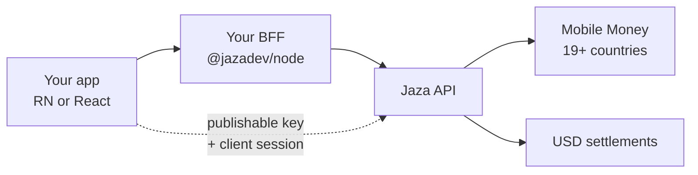

Jaza gives you everything to manage **Mobile Money in 19+ African countries**, FX at correct rates, and **USD merchant settlements** — so you can ship prepaid wallets and metered features without running your own aggregator.

**One integration, unlimited possibilities.**

## How integration works

1. **Configure** in the [dashboard](https://jaza.dev/dashboard) — markets, features, bundles, and API keys.
2. **Server** — `@jazadev/node` with your **secret** key creates customers, mints client sessions (`init`), and meters usage (`consume`).
3. **App** — `@jazadev/react-native` or `@jazadev/react` with your **publishable** key; your host handshake returns `InitResult` for `JazaProvider`.

<Note>
  A polished architecture image can replace or sit beside this diagram later. The flow above is the integration truth.
</Note>

## Choose your stack

Pick a backend and a frontend independently. Tab titles stay the same across docs pages so Mintlify can sync picks **within** a page.

### Backend

<Tabs>
  <Tab title="Node">
    Official server SDK: **`@jazadev/node`**. Holds the secret key. Owns `createCustomer`, `init`, `consume`, and webhook verification.
  </Tab>
</Tabs>

### Frontend

<Tabs>
  <Tab title="React Native">
    Official mobile SDK: **`@jazadev/react-native`** (Expo or bare React Native). Publishable key + client session. Widgets: `JazaBalance`, `JazaTopUpButton`, `JazaLedger`, `JazaActionButton`.
  </Tab>
  <Tab title="React">
    Official web SDK: **`@jazadev/react`** (Next.js, Remix, Vite, and more). Same product surface as React Native with a drawer-based top-up UI.
  </Tab>
</Tabs>

## Next steps

<CardGroup cols={2}>
  <Card title="Quickstart" icon="rocket" href="/quickstart">
    Keys → customer → init → provider → widgets → consume.
  </Card>
  <Card title="Core concepts" icon="book" href="/concepts/credits">
    Credits, wallets, features, bundles, and settlements.
  </Card>
</CardGroup>
