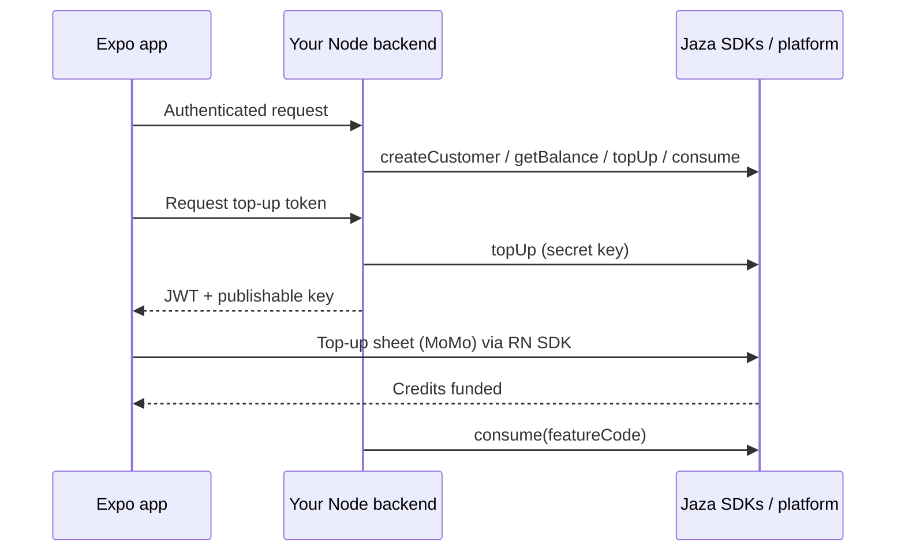

Jaza is **prepaid billing infrastructure** for African apps. You give every user a credit wallet, let them top up with Mobile Money, and meter features against a ledger your backend can trust.

## What you build vs what Jaza handles

<Columns cols={2}>
  <Card title="You ship" icon="code">
    - Feature costs and credit bundles in the [dashboard](https://jaza.dev/dashboard)
    - Customers via `@jazadev/node`
    - Balance + top-up UI via `@jazadev/react-native`
    - `consume` when users use a feature
  </Card>
  <Card title="Jaza handles" icon="building-columns">
    - Mobile Money collection across supported African markets
    - FX into a unified credit / USD model
    - Provider rails (you do **not** set up PawaPay yourself)
    - Merchant **settlements** — no multi-currency ops on your side
  </Card>
</Columns>

<Note>
  You do **not** need a PawaPay (or other aggregator) merchant account, per-country FX tables, or custom settlement plumbing. Enable markets in the dashboard; Jaza runs collection and settlement.
</Note>

## How integration works

1. **Dashboard** — create an app, configure markets & bundles, copy sandbox keys.
2. **Backend SDK** — `@jazadev/node` with your **secret** key.
3. **Mobile SDK** — `@jazadev/react-native` with your **publishable** key + short-lived top-up JWT from your server.

## Choose your stack

Pick the combination that matches your app. Docs guide you with that stack in mind.

<View title="Expo + Node" icon="mobile">
  Official path today. Use `@jazadev/react-native` in Expo and `@jazadev/node` on your API.

  <Card title="Quickstart" icon="rocket" href="/quickstart">
    Zero to balance, MoMo top-up, and consume in one guide.
  </Card>
</View>

<View title="React Web + Node" icon="react">
  <Card title="Coming soon">
    Web SDK is not published yet. Use Expo + Node for production integrations, or follow [@jazadev/node](/sdks/node) for server-only metering.
  </Card>
</View>

<View title="Flutter + Node" icon="mobile-screen">
  <Card title="Coming soon">
    Flutter client SDK is not available yet. Backend work can still use [@jazadev/node](/sdks/node).
  </Card>
</View>

## Next steps

<CardGroup cols={2}>
  <Card title="Quickstart" icon="rocket" href="/quickstart">
    End-to-end Expo + Node integration.
  </Card>
  <Card title="Concepts" icon="book" href="/guides/concepts">
    Credits, sandbox/live, and settlements.
  </Card>
  <Card title="Node SDK" icon="server" href="/sdks/node">
    `@jazadev/node` reference.
  </Card>
  <Card title="React Native SDK" icon="mobile" href="/sdks/react-native">
    Provider, balance widget, top-up button.
  </Card>
</CardGroup>
